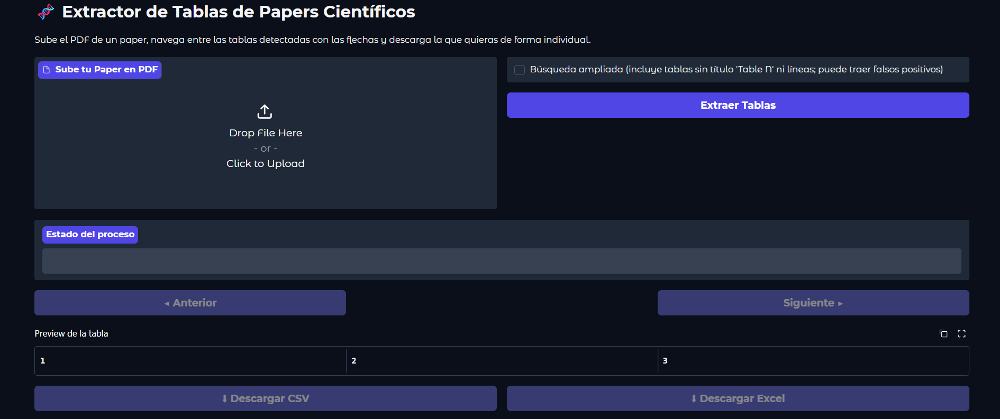

# 🧬 Paper Table Extractor

Aplicación web que extrae las tablas de papers científicos en PDF, las muestra una por una
con vista previa, permite descargarlas individualmente (CSV / Excel) y guardarlas en una
base de datos SQL (SQLite).




## Qué hace

- **Detecta tablas reales y descarta el texto corrido.** Los papers de dos columnas son un
  problema clásico: si se extrae "todo lo que parece una tabla", los párrafos terminan
  partidos en falsas celdas. Este proyecto combina varias señales para evitarlo (ver abajo).
- **Una tabla a la vez.** Navegación con flechas ◀ ▶, vista previa y título de la tabla
  (ej. *Table 2. Binding affinities…*).
- **Encabezados de varios niveles.** Una celda combinada como *Documented in experience*
  sobre dos subcolumnas se convierte en nombres de columna completos
  (`Documented in experience, n (%) – All experiences (n = 3778)`).
- **Descarga individual** en CSV o Excel.
- **Guardado en SQLite:** cada tabla como tabla SQL propia, más un `catalogo` con su origen.

## Instalación y uso

Requiere Python 3.9 o superior.

```bash
python -m venv .venv
source .venv/bin/activate        # en Windows: .venv\Scripts\activate
pip install -r requirements.txt
python app.py
```

Abrí http://127.0.0.1:7860, subí un PDF y presioná **Extraer Tablas**.

## Cómo detecta las tablas

Cada página pasa por tres etapas, de la evidencia más fuerte a la más débil:

1. **Grilla dibujada:** tablas con líneas verticales y horizontales.
2. **Título "Table N":** se busca el título y se extrae solo la zona debajo de él. Si hay
   líneas horizontales (estilo *booktabs*: arriba, bajo el encabezado y abajo), se recorta
   exactamente entre ellas. Las columnas se reconstruyen por los espacios en blanco verticales
   entre palabras (`columnas.py`), así nunca se corta una palabra por la mitad.
3. **Búsqueda ampliada (opcional, desactivada por defecto):** tablas sin título ni líneas,
   con criterios más estrictos (columnas numéricas) porque la evidencia es débil.

Cada candidata pasa además por un **filtro anti-párrafos** (`validacion.py`): se descarta si
tiene muchas celdas con 6 o más palabras, si son fragmentos que empiezan en minúscula sin
números, o si está casi vacía. Los umbrales están en `extractor_tablas/config.py`.

## Base de datos

Al guardar, se crea (o se actualiza) un archivo SQLite, por defecto `tablas_papers.db`:

- una tabla SQL por cada tabla extraída, con nombre `<pdf>__p<página>_t<n>`;
- una tabla `catalogo` con el PDF de origen, página, título, filas y columnas.

Volver a guardar la misma tabla la reemplaza en lugar de duplicarla.

```bash
sqlite3 tablas_papers.db
```
```sql
SELECT nombre_sql, archivo, pagina, titulo, filas FROM catalogo;
SELECT * FROM "paper_dmt_2024__p3_t1";
```

También se puede leer desde Python:

```python
import sqlite3, pandas as pd
con = sqlite3.connect("tablas_papers.db")
df = pd.read_sql('SELECT * FROM "paper_dmt_2024__p3_t1"', con)
```

> Todos los valores se guardan como texto (por ejemplo `"1415 (37.5)"`), porque las tablas de
> papers suelen mezclar números con porcentajes, desvíos y símbolos.

## Estructura del proyecto

```
app.py                      # interfaz Gradio
extractor_tablas/
├── config.py               # umbrales y expresiones regulares
├── texto.py                # limpieza de celdas, ¿es numérica?
├── geometria.py            # segmentos de texto, recortes, líneas, títulos
├── columnas.py             # columnas por espacios en blanco entre palabras
├── encabezados.py          # encabezados multinivel y armado del DataFrame
├── validacion.py           # ¿tabla real o texto corrido?
├── detector.py             # orquesta la extracción por página
├── exportacion.py          # CSV / Excel
└── base_datos.py           # guardado en SQLite
tests/                      # pruebas unitarias y de punta a punta
```

## Tests

```bash
pip install -r requirements-dev.txt
pytest
```

Los tests de punta a punta generan PDFs sintéticos (`tests/pdf_ejemplo.py`) que imitan un
paper: dos columnas de texto, una tabla con grilla y encabezado combinado, y tablas estilo
*booktabs*. Verifican, entre otras cosas, que las páginas de puro texto no generen falsos
positivos.

El proyecto se fue refinando con tablas de papers reales; los tests usan PDFs sintéticos para
que sean reproducibles sin depender de documentos con copyright.

## Limitaciones conocidas

- Se asume que el título ("Table N") está **encima** de la tabla.
- En papers de dos columnas, una tabla **sin líneas** dentro de una sola columna puede
  arrastrar texto de la otra columna. El filtro anti-párrafos suele descartarla.
- Una celda con texto en varias líneas, en una tabla sin grilla, puede aparecer como filas
  separadas.
- Las celdas combinadas se resuelven para encabezados (hasta 3 niveles), pero no dentro del
  cuerpo de la tabla.
- No hay OCR: no funciona con PDFs escaneados ni con tablas insertadas como imagen.
- Las filas de categoría (por ejemplo "Somatic") quedan como filas con celdas vacías.

## Próximos pasos

- Convertir las filas de categoría en una columna `Category`.
- Separar valores como `1415 (37.5)` en columnas numéricas (n y %).
- Soporte para OCR en PDFs escaneados.
- Reconocer títulos ubicados debajo de la tabla.

## Licencia

MIT. Ver [LICENSE](LICENSE).
