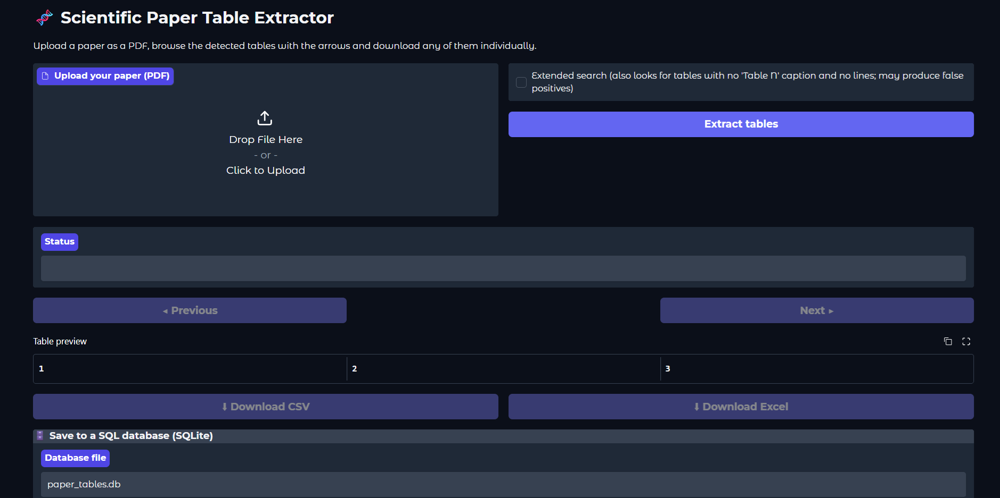

# 🧬 Paper Table Extractor

A web app that extracts tables from scientific papers in PDF format, shows them one at a time
with a preview, lets you download each one individually (CSV / Excel) and save them to a SQL
database (SQLite).



## Features

- **Detects real tables and discards running text.** Two-column papers are a classic problem:
  if you extract "everything that looks like a table", paragraphs end up split into fake
  cells. This project combines several signals to avoid that (see below).
- **One table at a time.** Navigate with ◀ ▶ arrows, with a preview and the table's caption
  (e.g. *Table 2. Binding affinities…*).
- **Multi-level headers.** A merged cell such as *Documented in experience* spanning two
  subcolumns is turned into full column names
  (`Documented in experience, n (%) – All experiences (n = 3778)`).
- **Multilingual captions:** `Table`, `Tabla`, `Tabela`, `表`, `표`.
- **Individual download** as CSV or Excel.
- **Save to SQLite:** each table becomes its own SQL table, plus a `catalog` table recording
  where it came from.

## Installation and usage

Requires Python 3.9 or higher.

```bash
python -m venv .venv
source .venv/bin/activate        # on Windows: .venv\Scripts\activate
pip install -r requirements.txt
python app.py
```

Open http://127.0.0.1:7860, upload a PDF and click **Extract tables**.

## How tables are detected

Each page goes through three stages, from the strongest evidence to the weakest:

1. **Drawn grid:** tables with vertical and horizontal ruling lines.
2. **"Table N" caption:** the caption is located and only the area below it is extracted. If
   there are horizontal rules (*booktabs* style: top, under the header, bottom), the region is
   cropped exactly between them. Columns are reconstructed from the vertical white space
   between words (`columns.py`), so a word is never cut in half.
3. **Extended search (optional, off by default):** tables with no caption and no lines, using
   stricter criteria (numeric columns) because the evidence is weaker.

Every candidate also goes through an **anti-paragraph filter** (`validation.py`): it is
discarded if it has many cells with 6 or more words, if its cells are lowercase-initial
fragments with no numbers, or if it is mostly empty. For Chinese and Japanese, which are
written without spaces, words are approximated by character count. The thresholds live in
`table_extractor/config.py`.

## Database

When saving, a SQLite file is created (or updated), `paper_tables.db` by default:

- one SQL table per extracted table, named `<pdf>__p<page>_t<n>`;
- a `catalog` table with the source PDF, page, caption, number of rows and columns, and when
  it was saved.

Saving the same table again replaces it instead of duplicating it.

```bash
sqlite3 paper_tables.db
```
```sql
SELECT sql_name, file, page, caption, n_rows FROM catalog;
SELECT * FROM "paper_dmt_2024__p3_t1";
```

It can also be read from Python:

```python
import sqlite3, pandas as pd
con = sqlite3.connect("paper_tables.db")
df = pd.read_sql('SELECT * FROM "paper_dmt_2024__p3_t1"', con)
```

> All values are stored as text (for example `"1415 (37.5)"`), because paper tables often mix
> numbers with percentages, deviations and symbols.

## Project structure

```
app.py                      # Gradio interface
table_extractor/
├── config.py               # thresholds and regular expressions
├── text_utils.py           # cell cleaning, "is it numeric?", word counting
├── geometry.py             # text segments, crops, ruling lines, captions
├── columns.py              # columns from white space between words
├── headers.py              # multi-level headers and DataFrame building
├── validation.py           # real table or running text?
├── detector.py             # orchestrates per-page extraction
├── export.py               # CSV / Excel
└── database.py             # saving to SQLite
tests/                      # unit and end-to-end tests
```

## Tests

```bash
pip install -r requirements-dev.txt
pytest
```

The end-to-end tests generate synthetic PDFs (`tests/sample_pdf.py`) that mimic a paper: two
columns of running text, a table with a grid and a merged header, *booktabs*-style tables, and
Japanese and Korean pages. Among other things, they verify that pages of plain text do not
produce false positives.

The project was refined using tables from real papers; the tests use synthetic PDFs so they
are reproducible without depending on copyrighted documents.

## Known limitations

- The caption ("Table N") is assumed to be **above** the table.
- In two-column papers, a table **without lines** inside a single column may pull in text from
  the other column. The anti-paragraph filter usually discards it.
- A multi-line cell in a table without a grid may show up as separate rows.
- Merged cells are handled for headers (up to 3 levels), but not inside the table body.
- No OCR: it does not work with scanned PDFs or tables embedded as images.
- Category rows (for example "Somatic") are kept as rows with empty cells.
- Japanese and Korean support is covered by synthetic PDFs only; it has not been validated on
  a large set of real papers. Vertical (tategaki) text is not supported.

## Next steps

- Turn category rows into a `Category` column.
- Split values such as `1415 (37.5)` into numeric columns (n and %).
- OCR support for scanned PDFs.
- Recognize captions placed below the table.

## License

MIT. See [LICENSE](LICENSE).
